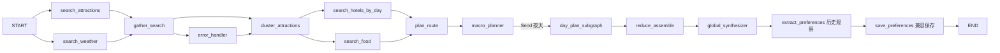
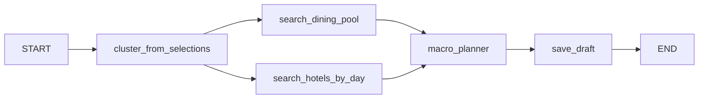

# 当前运行架构

2026-10-24，按已提交 `3b3a93c` 更新当前入口；下文LTP条目保留各阶段背景。本机单用户，支持单城及5～10天、2～3城市；框架版本保持锁定。领域术语见 [CONTEXT](../CONTEXT.md)，外部调用策略见 [说明](external-services.md)。

## 页面与入口

Vue应用使用组件局部状态，路由为 `/`、`/discover`、`/draft/:id`、`/result`、`/my-trips`、`/trip/:id`、`/multi-trip/:id?`。日常流程为填写本次需求 → 发现和勾选景点 → 分配日期 → 创建骨架草稿 → 装配和编辑每日安排 → 定稿 → 只读历史。定稿前修改在草稿完成。

`backend/run.py` 启动 `app.api.main:app`；默认后端8000、Vite5173，Vite将 `/api` 代理到后端，验证时可用 `VITE_BACKEND_URL` 指向隔离实例。FastAPI注册trip_lg、discover_router、trip_draft、trip_history、map_lg、poi_lg、admin，以及multi_trip、tickets。当前OpenAPI为52个路径；LTP-8的 `architecture-inventory.json` 是当时35路径的历史盘点，不能用作当前全表；当前方法以 `/openapi.json` 为准。

| 入口 | 实际执行 |
| --- | --- |
| `POST /api/trip/plan`、`/plan/stream` | 兼容一次性完整规划图；同步JSON或SSE结果，没有交互检查点 |
| `POST /api/trip/discover/stream` | 发现图，按景点事件和天气事件输出，最后完成 |
| `POST /api/discover/load_more`、`/ai_select` | 继续发现与从当前候选池筛选，不执行完整规划图 |
| `POST /api/trip/discover/search`、`/plan/preview-day-assignment` | 手动查询、日期分配预览及用户需求中的时长估计 |
| `POST /api/trip/draft/from-selections/stream` | 当前页面使用的骨架图；支持请求ID重放恢复原草稿 |
| `POST /api/trip/plan/from-selections/stream` | 兼容旧路径，仍执行相同骨架图并返回draft_id，已不是完整行程生成入口 |
| `/api/trip/draft/{id}/day/{day}/assemble`、`recompute`、`narrative`、`ai-rearrange` | 直接调用装配、路线、时段、预算及事实说明，逐日快照检查通过后同次保存当天JSON |
| `POST /api/trip/draft/{id}/finalize` | 独立定稿流水线，复用已保存日程；由当前结构化事实生成每日/全局说明和标题，保存历史和草稿状态，兼容观察记录参与同一事务 |
| `/api/multi-trips`及其preview/save/copy/cities子路径 | 整趟多城市聚合、显式城市快照、预览令牌/revision和只读版本保存 |
| `POST /api/tickets/recommend` | 传入单城/多城安排context时先排除冲突候选，再让模型只选既有ID；无context不代表已存安排适配，采用仍须预览确认 |
| `/api/trips` | 历史列表、详情、搜索、状态及删除；已有手动保存接口保留 |
| `/api/trip/preferences/{user_id}` | 既有明确偏好或观察数据的读写/删除管理，不自动影响任何规划入口 |
| `/api/map/*`、`/api/poi/*`、`/api/admin/attractions/*` | 地图/POI辅助与地点缓存管理；不代表账号或公开部署能力 |

## 三个图

定义均在 `agents/langgraph_agent/graph.py`，运行节点数分别为14、3、5，另有单日生成子图。

完整规划图：

发现图：START并行执行 `search_attractions_discovery` 和 `search_weather`，两者在 `gather_discovery` 汇聚后END。景点搜索节点内部使用缓存服务和真实高德数据；不是旧文档中的geocode_batch循环图。

骨架图：

骨架图不生成每日详情、全局建议或保存行程历史。五步完成事件与前端加载标签一致，酒店和餐饮为同级进度，避免完成顺序导致倒退。健康检查节点清单从实际编译图取得，区分三个图，不再硬编码旧节点。

## 状态与保存

唯一声明在 `app/models/state.py`：TripPlannerState、DiscoveryState、DayPlanLocalState。`agents/langgraph_agent/state.py`只重导出同一对象，保留现有导入路径，避免包导入循环。旧models/state中的未使用POI/Weather/Hotel等中间DTO已清理，API仍用schemas.py的Pydantic模型，未改变响应字段。

跨并行节点的errors、messages及按日/景点收集列表使用operator.add。SSE汇总只累加这些字段，选择列表和候选池等普通列表按节点新值替换，不再一律extend或修改初始列表。

`backend/data/trips.db`保存草稿JSON、历史、偏好旧记录和地点缓存。定稿在SQLite写事务中检查原快照、写历史与草稿状态并处理兼容观察记录；重复返回同一历史。显式偏好记录原样保留，不让自动行程观察改写。当前图不使用AsyncSqliteSaver、interrupt_before或反馈检查点；已有 `checkpoints.db`若存在只保留，不删除或迁移。

## 偏好边界

用户已确认本轮停用隐式历史加载与提示注入：本次表单、勾选、分配和编辑是规划依据。空兴趣标签不会回填旧兴趣；当前经济型住宿也不会被历史高档酒店取代。规划没有历史偏好通道，不把旧偏好夹带为系统消息或节点提示。

既有API和数据保留。为兼容原保存链，自动提取/合并仍可记录未标explicit的行程观察，字段名暂沿用preferred_*，但不参与下一次规划；它不是用户确认喜欢、实际消费或已成行的证明。显式记录不会被这种观察覆盖。未来如做表单预填，需要主动采用、可见可改，并单独核对旧数据来源；本轮不新增预填功能或永久禁忌模型。

## 依赖与兼容范围

当前运行代码没有HelloAgents导入；移除hello-agents及无运行引用的旧直接依赖aiohttp、loguru、fastmcp、uv、python-dateutil、huggingface_hub。其仅被旧依赖需要的传递包随闭包清理，锁从134项缩为75项，保留版本逐项不变。真实MCP仍由langchain-mcp-adapters及MCP SDK连接，不依赖fastmcp服务器框架。原 `.venv`未卸载或升级，完整旧锁在交接起点备份。

本次在全新macOS/Python3.12.13环境安装验证；其他系统、Python版本及框架迁移仍需另行评估。checkpoint-sqlite暂沿用原框架依赖基线，不表示启用检查点，是否移除随LTP-9评估。旧弃用文件若存在于用户本机，只作为参考，不注册路由、不自动删除。交互检查点和已不存在的反馈API不再列为现有功能。

## 行程说明与编辑一致性（LTP-10）

`assemble/narrative.py`将已保存活动顺序、timeline_schedule、餐次、日期匹配天气和费用缺项投影为说明，标记description_source/narrative_source为itinerary_facts_v1。重算、删除/恢复、改开始时间、改用餐、AI重排和强制装配均在成功保存前更新说明；定稿和手动保存历史再执行同一投影。模型继续参与规划与AI重排，不再为草稿每日说明或定稿标语另作调用。narrative接口保留兼容，界面改名“刷新行程说明”。缺失或与当前顺序/开始时间不符的旧时间轴不输出具体时刻，提示待重算；未知票价、住宿参考和预约状态不推测为免费、已预订或已预约。

所有四个每日写入入口在SQLite BEGIN IMMEDIATE内比较请求开始时的原始日JSON；同一天在途旧请求以409拒绝写入，不覆盖较新编辑，其他天独立保存不误冲突。前端409重新读取最新草稿，回读失败阻止继续保存并提示重载。一般地图/AI失败仍恢复上次成功保存状态。定稿继续检查全草稿快照、原子写入并幂等返回。

读取旧草稿、缓存装配及历史详情只做视图投影，不迁移或重写原JSON；不可解析旧历史隐藏旧说明，保留可用原始数据。旧记录未记录预算完整性时不靠解析默认值确认为完整。前端仅展示带当前来源的说明，按纯文本渲染外部地点名；旧Result本地编辑入口已关闭，避免绕过路线、费用、锁定与删除保护。日常编辑统一在DraftView。见 [LTP-10交接](ltp10-handoff.md)。

## 用餐位置与AI覆盖（LTP-11）

`assemble/meals.py`修复删除后失效的手动插入位置，按原时间轴寻找仍保留的前置景点，没有则放首景点前；auto用餐继续按餐次自动安排。AI提示提供已安排餐次和候选事实，归一化结果只从候选/当前已保存餐厅取数据，补回遗漏的已有正餐，拒绝未知/重复候选或未安排的新正餐；有效模型插入位置保留，失效才回退。实际路线之后核对真实餐次和营业窗口，不兼容则有界检查并保留原安排，不能保留则不写。110秒总期限包含全部步骤。

meal_adjustments只增加JSON字段，随当前编辑替换并纳入说明/预算和定稿；前端明示恢复/保留，减少或新增餐次通过草稿手动修改。当前未安排早餐不会自动补入，现有锁定、删除、快照和幂等保护保持。验证与限制见 [交接](ltp11-handoff.md)。

### P06 抵离交通（2026-10-15）

`models/journey.py` 校验手动交通与当地时区；`services/journey_service.py` 生成目的地每日可用窗口、实际住宿日期及按全体同行人合计的大交通费用。草稿新增交通预览/确认端点，预览令牌绑定整份请求/每日快照；每日重算、候选刷新和定稿事务同样检查请求快照。旧完整规划端点收到 journey 时拒绝，当前发现→草稿路径负责时间约束。所有新字段仅存JSON，见 [LTP-17交接](ltp17-handoff.md)。

## 整趟多城市旅行（2026-10-16）

`/multi-trip/:id?` → `/api/multi-trips` → multicity 领域服务，先确定城市停留与相邻交通，再进入原有城市发现/草稿流程。没有复制或扩展单城市 LangGraph 为一个大型多城图；每个城市仍有准确的单城市请求，整趟服务负责跨城时段、住宿晚数和预算汇总。城市工作副本显式导入快照，保存说明、每日活动和预算来自同一revision。聚合使用原TripDraft JSON、独立kind/ID/status；旧历史及单城路径不迁移。约束、验证和局限见[多城市交接](ltp21-ltp23-handoff.md)。
